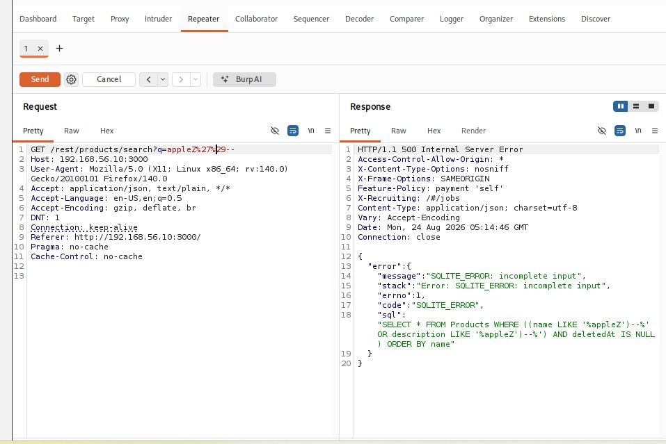

# Finding 2: Unauthenticated Information Disclosure via Verbose SQL Error

| | |
|---|---|
| **Category** | Security Misconfiguration / Injection |
| **Severity** | Medium |
| **Location** | Product search endpoint (`GET /rest/products/search?q=`) |

## Description

Submitting a malformed input to the product search field triggered an unhandled database error. The application returned the full, raw SQL error, including the exact query structure, table name, and column names, directly to an unauthenticated user.

## Steps to Reproduce

1. Use the search bar (or Burp Repeater) to submit: `appleZ'--`.
2. Observe the HTTP response.

## Result

A `500 Internal Server Error` was returned with the following leaked query:
```sql
SELECT * FROM Products WHERE ((name LIKE '%appleZ')--%'
OR description LIKE '%appleZ')--%') AND deletedAt IS NULL
) ORDER BY name
```



## Impact

Exposes internal database schema and query logic to any unauthenticated visitor, significantly aiding further attack planning (e.g. crafting precise injection payloads).

## Remediation

Disable verbose/debug error output in production. Catch database exceptions server-side and return generic error messages to the client.

## MITRE ATT&CK Mapping

| Activity | Technique |
|---|---|
| Error-based information disclosure | T1213, Data from Information Repositories |

---
[← Back to Project 3 overview](../README.md)
